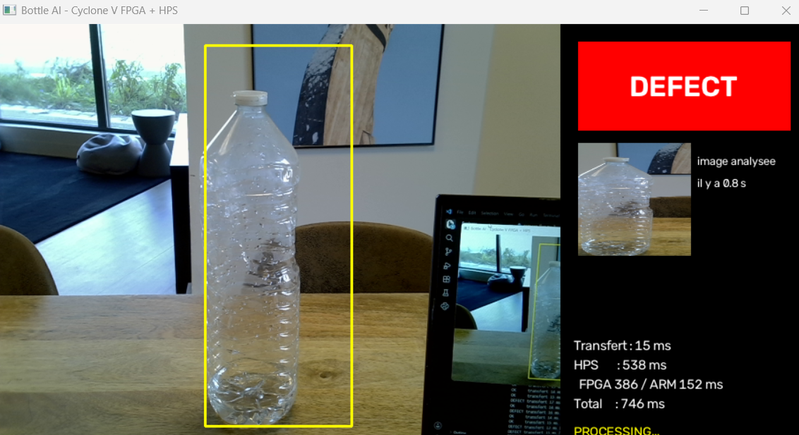
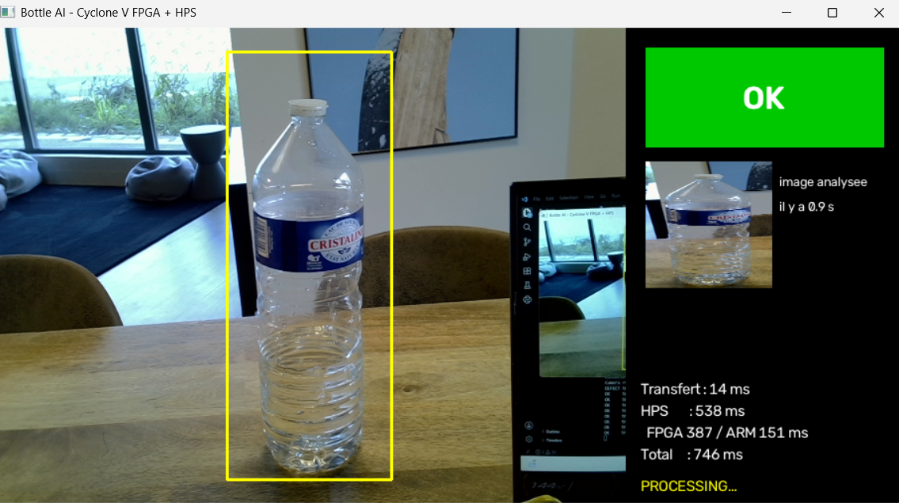

# FPGA + Edge AI Vision for Bottle Defect Inspection

Real-time bottle defect detection on a **Terasic DE10-Standard** (Intel Cyclone V SoC).
A USB webcam captures the bottle, a quantized **INT8 CNN** runs its three convolution layers
in custom **VHDL accelerators** on the FPGA, and the ARM processor finishes the network.
Each bottle gets one decision: **OK** or **DEFECT**.

| DEFECT | OK |
|---|---|
|  |  |

<sub>Live window: the yellow box is the area sent to the CNN; the panel shows the decision and the time spent in each stage.</sub>

---

## Table of contents

1. [Problem and goal](#1-problem-and-goal)
2. [Target platform](#2-target-platform)
3. [Approach](#3-approach)
4. [Studies](#4-studies)
5. [Final model](#5-final-model)
6. [System architecture](#6-system-architecture)
7. [FPGA accelerators](#7-fpga-accelerators)
8. [Validation](#8-validation)
9. [Results](#9-results)
10. [Challenges and lessons](#10-challenges-and-lessons)
11. [Next steps](#11-next-steps)
12. [Repository structure](#12-repository-structure)
13. [Getting started](#13-getting-started)

---

## 1. Problem and goal

On a production line, every bottle must be checked quickly and reliably. Manual inspection is slow
and inconsistent.

**Goal:** a complete inspection system that runs **at the edge**, on one embedded board, with no
cloud and no GPU.

| Constraint | What it means for the design |
|---|---|
| Low latency | The heavy computation runs in dedicated hardware |
| Fully local | Images never leave the inspection station |
| Simple output | One clear decision per bottle: OK or DEFECT |

---

## 2. Target platform

The **Terasic DE10-Standard** combines two processors on one chip, connected by internal AXI bridges.

| | FPGA fabric (Cyclone V SX) | Hard Processor System (HPS) |
|---|---|---|
| Resources | 41 910 ALMs, 112 DSP blocks, 553 M10K RAM blocks (5.6 Mbit) | Dual-core ARM Cortex-A9, 1 GB DDR3 |
| Software | VHDL, Quartus Prime 18.1, Platform Designer | rsYocto Linux, C/C++, Python 3, SSH |
| Role in the project | The three convolution layers | Control, data transfer, last layers |

---

## 3. Approach

We worked in five phases. Each phase was validated before starting the next one.

| Phase | Content |
|---|---|
| **1. Explore** | Datasets, model families, deployment options |
| **2. Decide** | Final model and hardware/software split |
| **3. Design** | One VHDL accelerator per convolution |
| **4. Integrate** | Platform Designer system, HPS software, camera |
| **5. Validate** | Bit-exact checks against the model, live tests on the board |

**Guiding rule:** a simple version that really works on the board comes before any optimization.

---

## 4. Studies

### 4.1 Data: three datasets, one lesson

| Step | Dataset | Why we moved on |
|---|---|---|
| 1 | **Bottle caps** (Roboflow), 1 354 images, 5 classes | We found **data leakage**: photos from the same capture burst were in both train and test. We re-split by burst. |
| 2 | **Whole bottles** (Roboflow `bottle_can_quality`), 5 337 images, bottles only | Detect defects on the whole bottle, not only the cap. But internet images did not look like our webcam images. |
| 3 | **Our own dataset**, Logitech C270, 300 photos (150 OK, 150 DEFECT) | **Final.** Same camera, lighting and framing as the demo. |

**Lesson:** train on images taken by the camera used in deployment.

### 4.2 Model choice: can it run in VHDL?

We compared five model families. The criterion was not only accuracy, but also how easily the
model can be written in VHDL.

| Model | Idea | Result (exploration) | Fit for FPGA |
|---|---|---|---|
| Small CNN | Supervised baseline | Accuracy 0.881 | ✅ Easy to port |
| DINO ViT-S/16 + linear probe | Self-supervised features | SSL reference | ❌ Too heavy |
| GlimpseNet | Visual attention + GRU | Experimental | ❌ Hard to port |
| YOLOv8n | Object detection, 320×320 | mAP50 94.6 % | ❌ Too large |
| Distilled CNN | MobileNetV2 teacher + quantization-aware training | Accuracy 0.896 | ✅ Easy to port |

<sub>Exploration scores were measured on the bottle-caps test set, not on the final dataset.</sub>

**Decision:** a plain 3-layer CNN quantized to INT8. Only three operation types to build in
hardware: convolution, ReLU and max pooling.

### 4.3 Hardware/software split

We counted the multiply-accumulate operations (MACs) of each layer:
**99.99 % of the 38.5 M MACs are in the three convolutions.**

| Option | Verdict |
|---|---|
| Everything on the ARM | Simple, but no hardware acceleration |
| Everything on the FPGA | Dense layers cost logic for almost no gain |
| **Convolutions on the FPGA, last layers on the ARM** | ✅ **Chosen** |

---

## 5. Final model

INT8 TensorFlow Lite model (`model/bottle_cnn_int8.tflite`), trained with TensorFlow/Keras on our
C270 dataset.

| Layer | Output shape | Parameters | MACs | Runs on |
|---|---|---|---|---|
| Input (RGB, INT8) | 128 × 128 × 3 | | | |
| Conv 3×3 (16) + ReLU + MaxPool | 63 × 63 × 16 | 448 | 6.86 M | FPGA |
| Conv 3×3 (32) + ReLU + MaxPool | 30 × 30 × 32 | 4 640 | 17.15 M | FPGA |
| Conv 3×3 (64) + ReLU | 28 × 28 × 64 | 18 496 | 14.45 M | FPGA |
| MaxPool + Global Average Pooling | 64 | | | ARM |
| Dense (32) + ReLU | 32 | 2 080 | 2 048 | ARM |
| Dense (2) + Softmax | 2 | 66 | 64 | ARM |
| **Total** | | **25 730** | **≈ 38.5 M** | |

Quantization: INT8 weights (per channel) and activations, INT32 biases, input scale 1 and
zero point −128.

---

## 6. System architecture

```mermaid
flowchart LR
    CAM["USB Webcam<br/>Logitech C270"] --> PC["PC<br/>crop 2.6:1 + resize 128x128<br/>INT8 quantization"]
    PC -- "SSH / SFTP<br/>49 152 bytes" --> HPS["ARM Cortex-A9 (HPS)<br/>rsYocto Linux"]
    HPS -- "AXI bridge" --> IN[("input_ram<br/>128x128x3")]
    IN --> C1["Conv1 + ReLU + MaxPool<br/>8 MAC lanes"]
    C1 --> P1[("pool1_ram<br/>63x63x16")]
    P1 --> C2["Conv2 + ReLU + MaxPool<br/>8 MAC lanes"]
    C2 --> P2[("pool2_ram<br/>30x30x32")]
    P2 --> C3["Conv3 + ReLU<br/>8 MAC lanes"]
    C3 --> P3[("pool3_ram<br/>28x28x64")]
    P3 -- "AXI bridge" --> ARM["ARM: MaxPool3 + GAP<br/>+ Dense 32 + Dense 2"]
    ARM --> RES["OK / DEFECT<br/>shown on the PC"]

    subgraph FPGA["Cyclone V FPGA fabric"]
        IN; C1; P1; C2; P2; C3; P3
    end
```



**Processing of one image:**

1. The PC captures a frame, crops the central 2.6:1 area, resizes it to 128×128 and quantizes it to INT8.
2. The image (49 152 bytes) is sent to the board over a persistent SSH connection.
3. The ARM writes it to `input_ram` and starts Conv1, Conv2 and Conv3, one after the other.
4. Each accelerator reads the previous RAM and writes the next one.
5. The ARM reads `pool3_ram`, computes the last layers and returns OK or DEFECT to the PC.

| Path | Bridge | Used for |
|---|---|---|
| Data | HPS-to-FPGA AXI bridge | The four on-chip RAMs (input, pool1, pool2, pool3) |
| Control | Lightweight HPS-to-FPGA bridge | Start and status registers of each accelerator |

---

## 7. FPGA accelerators

Each convolution is a custom **Avalon-MM component** written in VHDL and integrated with Platform Designer.

```
Input RAM ─► Line buffer ─► 8 MAC lanes ─► Requantize ─► ReLU + MaxPool ─► Output RAM
              (4 rows)      INT8×INT8→INT32  (M0, shift)      (fused)
                                 ▲
                         Weight / bias ROMs (.mif)
```

| Design choice | Benefit |
|---|---|
| **8 parallel MAC lanes** (`mac8_int8.vhd`) | 8 output channels computed in the same clock cycle |
| **On-chip line buffer** (4 image rows) | Each pixel is not re-read from RAM for every window |
| **Per-channel requantization** (M0 multiplier + shift) | Same arithmetic as TensorFlow Lite |
| **Fused ReLU + MaxPool** | Fewer memory writes |
| **Weights in on-chip ROMs** (`.mif`) | No weight transfer at run time |

**Memory map**

| Component | Bridge | Base address | Size |
|---|---|---|---|
| `input_ram` | HPS-to-FPGA | `0x0000_0000` | 49 152 B |
| `pool1_ram` | HPS-to-FPGA | `0x0001_0000` | 63 504 B |
| `pool2_ram` | HPS-to-FPGA | `0x0002_0000` | 28 800 B |
| `pool3_ram` | HPS-to-FPGA | `0x0003_0000` | 50 176 B |
| `conv1_finale_corrige_0` | Lightweight | `0x0004_0000` | registers |
| `conv2_finale_corrected_0` | Lightweight | `0x0005_0000` | registers |
| `conv3_finale_0` | Lightweight | `0x0006_0000` | registers |

---

## 8. Validation

A quantized network is fragile: one wrong byte order or scale factor makes the output meaningless.
We checked each link of the chain against the reference model.

| Check | Result |
|---|---|
| **Weights and biases:** the 6 `.mif` files compared with the TFLite tensors | ✅ Bit-identical (23 472 weights, 112 biases) |
| **Requantization:** VHDL multipliers compared with those recomputed from the model scales | ✅ Match |
| **Pre-processing:** crop, bilinear resize, input zero point | ✅ Same as training |
| **On the board:** full chain, live camera | ✅ Works end to end |

---

## 9. Results

### Timing (measured live, per image)

| Stage | Time |
|---|---|
| FPGA: Conv1 to Conv3 | **386 ms** |
| ARM: last layers | **152 ms** |
| Total on the board | **538 ms** |
| Image transfer PC → board | ~15 ms |
| End-to-end (PC → board → PC) | **746 ms** |

### FPGA resources (Quartus Prime 18.1 Lite, device 5CSXFC6D6F31C6)

| Resource | Used | Available | Utilization |
|---|---|---|---|
| Logic (ALMs) | 32 779 | 41 910 | 78 % |
| Registers | 51 972 | | |
| Block memory bits | 1 940 736 | 5 662 720 | 34 % |
| RAM blocks (M10K) | 283 | 553 | 51 % |
| DSP blocks | 41 | 112 | 37 % |

<sub>Whole system, including the HPS interconnect.</sub>

<!-- TODO: add the test accuracy of the final model -->

---

## 10. Challenges and lessons

| Challenge | Response |
|---|---|
| Data leakage in a public dataset | Re-split by capture burst, then built our own dataset |
| Internet images do not look like our webcam images | 300 photos taken with the deployment camera |
| Risk of quantization errors in hardware | Reuse the TFLite multipliers, bit-exact checks |
| Slow SSH handshake for each image | One persistent SSH connection, reused for every image |
| Fmax 41.5 MHz, below the 50 MHz clock | Documented as a known limitation, fix planned |

> **Timing note:** the `CLOCK_50` domain reaches an Fmax of **41.5 MHz** (setup slack −4.1 ns at
> 50 MHz, slow 85 °C model). The design works on the board, but timing is not formally closed.

---

## 11. Next steps

- **Close timing at 50 MHz:** pipeline the requantization path, or run the accelerators from a 40 MHz PLL.
- **Reduce FPGA time:** at 8 MACs per cycle and 50 MHz, the convolutions would take about 96 ms in
  theory, against 386 ms measured. Memory waits and row loading are the main targets.
- **Pipeline the three layers** and use the free DSP blocks for more parallelism.
- **Capture on the board** to remove the PC and the SSH transfer from the loop.
- **Richer dataset:** more photos, lighting conditions and defect types.

---

## 12. Repository structure

```
fpga-edge-ai-vision/
├── hardware/
│   ├── rtl/                 VHDL sources of the CNN accelerators
│   │   ├── mac8_int8.vhd              8-lane INT8 multiply-accumulate unit
│   │   ├── conv1_finale_corrige.vhd   Conv1 + ReLU + MaxPool
│   │   ├── conv2_finale_corrected.vhd Conv2 + ReLU + MaxPool
│   │   └── conv3_finale.vhd           Conv3 + ReLU
│   ├── quartus/             Quartus project, Platform Designer system, component _hw.tcl files
│   ├── mif/                 Weight and bias ROM contents
│   └── bitstream/           soc_system.rbf + device-tree overlay (fpga.dtbo)
├── software/
│   ├── pc/                  Live camera client (Python)
│   └── hps/                 Programs running on the ARM (Linux)
├── model/                   Quantized INT8 TFLite model
└── docs/images/             Demo screenshots
```

---

## 13. Getting started

### 1. Program the FPGA
On the board (rsYocto Linux), load `hardware/bitstream/soc_system.rbf` with the device-tree overlay `fpga.dtbo`.

### 2. Install the HPS software
Copy the content of `software/hps/` to `/root/ai` on the board.

### 3. Run the live demo on the PC
```bash
cd software/pc
pip install -r requirements.txt
python camera_live_v2.py --host <BOARD_IP> --model ../../model/bottle_cnn_int8.tflite
```
Press `Q` to quit.

### Rebuild the FPGA design (optional)
1. Open `hardware/quartus/DE10_Standard_GHRD.qpf` in **Quartus Prime 18.1**.
2. Open `soc_system.qsys` in **Platform Designer** and click **Generate HDL**.
3. Compile the project (**Processing → Start Compilation**).
4. Convert the `.sof` into `soc_system.rbf`:
   ```bash
   quartus_cpf -c output_files/DE10_Standard_GHRD.sof -o bitstream_compression=on soc_system.rbf
   ```

---

## Tech stack

VHDL · Quartus Prime 18.1 · Platform Designer · Intel Cyclone V SoC · ARM Cortex-A9 ·
rsYocto Linux · C/C++ · Python · OpenCV · TensorFlow / TFLite

## Authors

- Rania Ben Aicha
- Ghassen Mahmoud

Personal project carried out by ESIGELEC students (Rouen, France), 2026.
